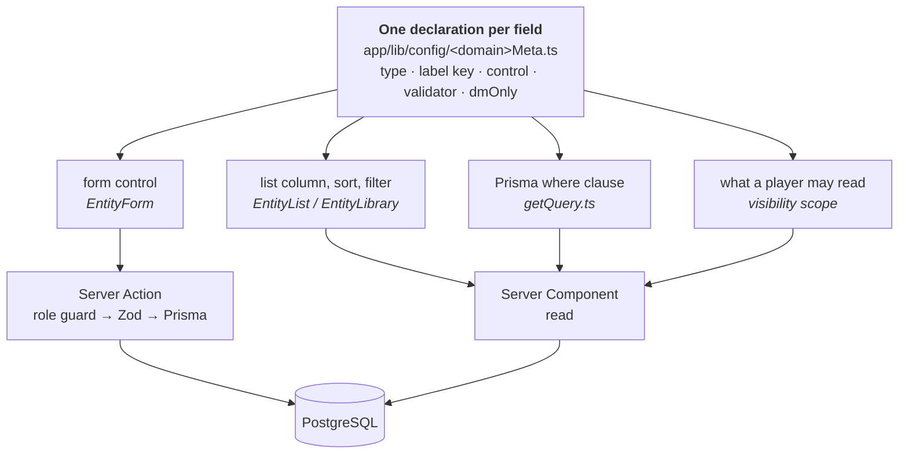

# Campaign Settings

[](https://github.com/pastorello/nextjs-campaign-settings/actions/workflows/ci.yml)
[](./docs/TESTING.md#coverage-targets)
[](./LICENSE)

A self-hosted web app for building the **setting** of a tabletop roleplaying campaign: the world's
geography on an interactive map, the people and gods and factions who live in it, the rules
catalogues of two different game systems, and the campaigns and adventures played inside it.

> **Why this repository is public.** So the code can be read. It is one game master's tool for one
> world — self-hosted for a single table, not packaged for reuse — so there is no hosted demo and no
> deploy guide, and that is a scope decision rather than an unfinished one. Putting it on a domain is
> specified work that is deliberately deferred ([SPEC-012](./docs/specs/012-publishing-and-internet-exposure.md)),
> because opening it to the internet changes who may log in before it changes anything else.
> If you want the short version of how it is built, read [How it works](#how-it-works) and then
> [If you only have ten minutes](#if-you-only-have-ten-minutes).

---

## The problem

A campaign setting is not a list of records, it is a graph. A deity has a domain and a holy city; the
city sits inside a region, which sits on a continent; an NPC belongs to a faction, lives in that
city, and knows a secret the players must not read yet. The same world then gets played under
different rule sets — one table plays fifth edition, another plays Daggerheart™ Compatible rules, and
the two share the geography, the gods and the history while sharing none of the mechanics.

Spreadsheets and documents model the records and lose the graph. Virtual tabletops model the session
and not the setting. What was missing was the thing in between: a place to **design** a world, where
every relation is a real relation, the map is the index, and what a player may see is a property of
the data rather than of the document they were sent.

That is what this is. It is also, deliberately, not a virtual tabletop: what happens at the table —
initiative, dice, hit points — was specified, reconsidered and
[dropped](./docs/ROADMAP.md#explicitly-not-planned). This app is used while _preparing_.

## What it does today

**The world.** An interactive Leaflet map of uploaded world maps, with a tree of places —
continents, regions, cities, districts — that nest to any depth. A place can own its own map, so
zooming into a region opens the region's own sheet. Areas are polygon footprints with real
containment tests, not bounding boxes ([ADR-0019](./docs/adr/0019-polygon-geometry-from-small-libraries.md),
after rectangles proved unable to describe a border). Landmarks sit on a place's map, distances are
measurable in the map's own scale, and a place not yet positioned waits in one unplaced pool instead
of disappearing.

**The people and the lore.** NPCs, deities, factions and treasures, each anchored to where they are
in the world. World history and a campaign calendar run on date systems the DM defines — a custom
calendar with its own months, moon phases and zodiac — stored as a universal day number so two
calendars can describe the same day ([ADR-0015](./docs/adr/0015-time-as-a-universal-day-number.md)).

**Two rule systems over one world.** `dnd5e` and `daggerheart` are both live, as a path segment
rather than a fork: `/dashboard/dnd5e/spells`, `/dashboard/daggerheart/domains`
([ADR-0013](./docs/adr/0013-game-systems.md)). Seventeen catalogues are declared in the metadata
layer: three belong to 5e (spells, magic items, treasures), eleven to Daggerheart (domains, domain
cards, classes, subclasses, ancestries, communities, adversaries, environments, weapons, armor,
loot), and three — NPCs, deities, factions — are the world's own and shared by both. A system's
catalogue is a 404 under the other system, enforced on the route rather than hoped for.

**Campaigns and adventures.** A campaign holds adventures, an adventure holds scenes, a scene holds
its creatures and its loot. Budgets are computed per system: a 5e adventure counts XP against SRD
5.2.1 encounter budgets and shows a difficulty band, a Daggerheart adventure counts milestones and
prices fights in Battle Points. Several campaigns can run in one system, and a campaign can be
archived or copied whole.

**Who sees what.** Accounts have roles. A player reads the setting without the fields written for
the DM's eyes — `secrets`, `motivations` and anything else declared `dmOnly` in its field metadata —
and sees only what their own campaign has uncovered, inherited down the world tree. Every mutation
and every write endpoint passes a role guard
([ADR-0020](./docs/adr/0020-roles-in-the-session-and-four-guards.md)) — with one documented
exception, the logged-out DM sign-up, which by definition has no session and can create nothing but
an inactive account another DM must activate.

**Everywhere.** The UI ships in Italian and English from message catalogues, never from strings in
JSX ([ADR-0006](./docs/adr/0006-bilingual-ui.md)); the DM's own content is never translated. Every
description field is a rich-text editor whose output is sanitised on write and again on render
([ADR-0016](./docs/adr/0016-formatted-text-as-sanitised-html.md)). Records carry an image, stripped
of metadata and resized server-side, served only to a logged-in session
([ADR-0017](./docs/adr/0017-record-images.md)). Search crosses domains — and deliberately excludes
the DM's private working material.

## How it works

Next.js App Router. Server Components read PostgreSQL through Prisma, Server Actions write, and there
is no REST layer for domain data ([ADR-0004](./docs/adr/0004-server-actions-over-rest-api.md)) — the
route handlers that exist are the deletes, the map and record image routes, and two read-only GeoJSON
endpoints.

The idea the codebase is organised around is the **metadata layer**. Each field of each domain is
declared exactly once — its type, its label key, its form control, its Zod validator, whether it is
DM-only — and that single declaration drives the form, the list column, the filter, the Prisma
`where` clause and the validation at the write boundary
([ADR-0003](./docs/adr/0003-metadata-driven-domain-configuration.md)).



Adding a field to a domain is one edit to one file. Hardcoding a field in a component is a
regression even when it works, which is why the rule is written down — and the one case where a
bespoke editor is correct is written down too, with the test for telling them apart
([ADR-0011](./docs/adr/0011-inline-collections-outside-the-metadata-layer.md)).

## What is worth a reviewer's time

- **The abstraction is type-checked, not trusted.** `PageMeta` is a discriminated union on
  `fieldType`, the registry keys survive inference, the query layer is generic over the Prisma
  `where` type. The `any` count is zero and `no-explicit-any` is an ESLint **error**, so it stays
  zero. Where the compiler cannot help — the metadata layer is string-keyed in places — invariant
  tests stand in for it, including one that would have caught a field-name collision silently
  overwriting a declaration.
- **Tests are shaped by what can actually break.** 531 unit and component test files under Vitest,
  54 Playwright specs including an axe-core accessibility suite and a mobile-viewport suite. Bug
  fixes land with the regression test that reproduces them. Coverage is a ratchet enforced in CI,
  raised when a change earns it and never lowered — and it is treated as a diagnostic, not a goal
  ([`docs/TESTING.md`](./docs/TESTING.md)).
- **CI has four jobs and they all block:** lint + typecheck + formatting, unit tests with coverage
  thresholds against a real Postgres, production build, and the full E2E suite. `next`, `react` and
  `prisma` are pinned exactly; pnpm's version comes from `package.json` so CI and a laptop cannot
  drift.
- **Decisions are written down before the code, and corrected in public.** 20 ADRs, 31 specs. A
  spec is written from an interview with the person who will use the feature, carries the answers it
  was agreed on, and ends with an outcome section saying what actually shipped. When a decision was
  wrong it gets a dated supersession note rather than a quiet edit: rectangles became polygons,
  "Italian identifiers are deliberate" turned out to be an inference recorded as intent
  ([ADR-0005](./docs/adr/0005-english-identifiers.md)), and a 50-call-site `revalidatePath` cleanup
  was reversed twice before it landed behind one helper
  ([ADR-0014](./docs/adr/0014-corrected-revalidate-paths-behind-a-helper.md)).
- **Nothing stays half-tracked.** TD-01 through TD-154 are closed and archived _with_ their
  write-ups, so [`TECH_DEBT_ARCHIVE.md`](./docs/TECH_DEBT_ARCHIVE.md) doubles as the record of what
  was tried and rejected — which is the thing git history cannot tell you. The last entry is a
  worked example of the habit: a licence finding from 2026-09-11 had never reached the register, so
  rewriting this README filed it as TD-154 and it was closed the same day. The habit underneath is
  auditing the docs against the code: counts and statuses rot, reasoning does not, so the documents
  that had drifted were corrected _with the evidence of the drift left in place_.
- **Rules structure in the repository; rules text in the DM's own database.** Game mechanics are not
  copyrightable, rulebook prose is, so the catalogues ship as field shapes and the content is
  whatever the DM wrote. The one place SRD material is restated (5e's CR-to-XP and encounter budget
  tables) carries its CC-BY attribution in [`NOTICE.md`](./NOTICE.md) and in an in-app credits page
  kept word-for-word equal to it by a test. Three publishers' licences were read before the
  multi-system work was built, and that reading
  ([`docs/domain/licensing.md`](./docs/domain/licensing.md)) is also what caught the repository
  breaking its own rule: eight seeded demo records carried Italian rulebook prose. Fixing it
  (TD-154) replaced ten values, not the eight the finding had counted — two `upcast` paragraphs are
  rich text as well.

## If you only have ten minutes

1. **The idea.** [`app/lib/config/pageMetaFields.ts`](./app/lib/config/pageMetaFields.ts) — every
   field, declared once — then [`app/lib/data/getQuery.ts`](./app/lib/data/getQuery.ts), where those
   declarations become a Prisma query, and [ADR-0003](./docs/adr/0003-metadata-driven-domain-configuration.md)
   for why.
2. **A decision reversed, with reasons.** [ADR-0005](./docs/adr/0005-english-identifiers.md): the
   codebase's Italian domain vocabulary had been documented as a deliberate choice; it was not, it
   was inferred from the code and recorded as intent in error. The ADR says so and the rename
   followed.
3. **A feature from interview to shipped.** [SPEC-022](./docs/specs/022-accounts-roles-and-party-visibility.md):
   accounts, roles and per-campaign visibility. §1 is the problem, §9 the DM's answers to the open
   questions, §11 what shipped and what is still open.
4. **A test suite.** [`app/lib/data/getQuery.test.ts`](./app/lib/data/getQuery.test.ts) for the
   risky part — query construction from metadata — and
   [`e2e/player-journey.spec.ts`](./e2e/player-journey.spec.ts) for the thing a user would notice
   breaking.
5. **How the project is run.** [`CLAUDE.md`](./CLAUDE.md) and
   [`docs/AGENT_WORKFLOW.md`](./docs/AGENT_WORKFLOW.md) — the conventions, the non-negotiable rules,
   and the list of approaches already weighed and rejected, which exists because the most repetitive
   failure mode in a long-running project is re-proposing a dead idea with a fresh rationale.

## Stack

| Layer      | Choice                                        | Why                                                                                                           |
| ---------- | --------------------------------------------- | ------------------------------------------------------------------------------------------------------------- |
| Framework  | Next.js 16, App Router                        | Server Components keep database access on the server, with no API layer to maintain and keep in sync          |
| Language   | TypeScript 5.9, `strict`                      | The metadata layer is the kind of abstraction that only pays off if the compiler checks it                    |
| Database   | PostgreSQL + Prisma 7 (`@prisma/adapter-pg`)  | Array columns map cleanly; 35 models and 34 migrations, every one applied by `migrate deploy`                 |
| Auth       | NextAuth v5 + bcrypt, credentials only        | Roles live in the session and are checked by four guards, one per surface                                     |
| Validation | Zod 4                                         | Declared per field in the metadata, so the form and the write boundary cannot disagree                        |
| i18n       | next-intl                                     | Italian and English catalogues, with a CI check that neither locale is missing a key                          |
| Styling    | Tailwind CSS v4                               | Utilities in the markup; there is no design system yet, and the roadmap says what specifying one would settle |
| Maps       | Leaflet + Turf / polygon-clipping / polylabel | Self-hosted images, no tile account, no API key; the geometry comes from small single-purpose libraries       |
| Editor     | Tiptap 3 + sanitize-html                      | Rich text stored as a restricted HTML fragment, sanitised on write and on render                              |
| Images     | sharp                                         | Uploads decoded, stripped of metadata and resized server-side; originals are not kept                         |
| Tests      | Vitest 5 + Testing Library · Playwright + axe | Native ESM/TS unit suite, browser E2E, accessibility in the same pipeline                                     |

## Running it

Requires Node 24, pnpm and Docker. Setup, configuration, seeding, importing a real library and
running the test suites are in **[`docs/SETUP.md`](./docs/SETUP.md)** — including the two
prerequisites the E2E suite fails loudly without.

```bash
pnpm install && docker-compose up -d
pnpm prisma migrate deploy && pnpm db:seed
pnpm dev
```

## Documentation

The repository is documented for whoever opens it next, which is usually a future session of the
maintainer's own work.

| Document                                           | What it covers                                                 |
| -------------------------------------------------- | -------------------------------------------------------------- |
| [`docs/SETUP.md`](./docs/SETUP.md)                 | Install, configure, seed, import, run the tests                |
| [`docs/ARCHITECTURE.md`](./docs/ARCHITECTURE.md)   | How the pieces fit, and where they diverge                     |
| [`docs/PROJECT_STATE.md`](./docs/PROJECT_STATE.md) | Inventory: stack, layout, data model, current health           |
| [`docs/ROADMAP.md`](./docs/ROADMAP.md)             | Five phases, the feature backlog, and the explicit non-goals   |
| [`docs/TESTING.md`](./docs/TESTING.md)             | Test strategy, coverage policy, E2E setup                      |
| [`docs/TECH_DEBT.md`](./docs/TECH_DEBT.md)         | Debt register — open items, and nothing else                   |
| [`docs/adr/`](./docs/adr/)                         | 20 architecture decision records — the _why_                   |
| [`docs/specs/`](./docs/specs/)                     | 31 feature specs, written before the code                      |
| [`docs/domain/`](./docs/domain/)                   | Game rules restated in our own words, and the licence analysis |
| [`CLAUDE.md`](./CLAUDE.md)                         | Conventions, rules, and decisions already rejected             |

[`docs/README.md`](./docs/README.md) explains how those fit together — and carries the audits that
caught them drifting.

## Status and direction

A working prototype that is used, not a product. It runs self-hosted behind a login for one table;
the intent is to put it on a domain, which is why accounts and roles shipped first and why
[SPEC-012](./docs/specs/012-publishing-and-internet-exposure.md) is the gate rather than a
deployment script. Export and import of a setting is what is being specified now. Not planned,
deliberately: real-time collaboration, a virtual tabletop, table-time tooling, multi-tenant hosting
and AI-generated content — each with its reason in [`docs/ROADMAP.md`](./docs/ROADMAP.md).

## Licence

[MIT](./LICENSE) for the code. Campaign content belongs to whoever wrote it, and the SRD 5.2.1
material the repository restates is attributed in [`NOTICE.md`](./NOTICE.md).

Not affiliated with, endorsed by or sponsored by Wizards of the Coast or Darrington Press. System
names here are descriptive references: the 5e side is compatible with fifth edition, and the
Daggerheart side is **Daggerheart™ Compatible** — the repository holds none of that system's SRD
content, which its community licence would not permit in this format. The reading behind both is
[`docs/domain/licensing.md`](./docs/domain/licensing.md).

<sub>Counts in this file were derived on 2026-10-15 and are re-derivable: `grep -c '^model' prisma/schema.prisma`,
`ls prisma/migrations | wc -l`, `find app __test__ e2e -name '*.test.ts*' | wc -l`, `ls e2e/*.spec.ts | wc -l`,
`ls docs/adr/0*.md docs/specs/0*.md`. Prose about _why_ does not rot; numbers do.</sub>
